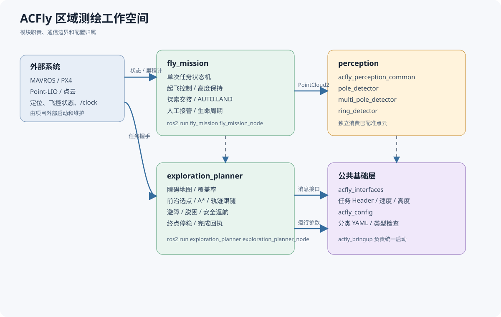

# ACFly 区域测绘工作空间

## 文件导览

```text
acfly_ws/
├── .clang-format  # C/C++ 排版规则：缩进、行宽、指针和头文件顺序
├── .editorconfig  # 编辑器通用规则：字符编码、换行、缩进与行末空白
├── .gitignore     # 指定 Git 忽略的构建产物、录包和本机文件
├── .vscode/       # VS Code 工作区设置
│   └── settings.json  # 设置 CMake Tools 的源码目录，当前指向旧台架工程
├── AGENTS.md      # 本仓库的协作约定、任务交接和证据核对要求
├── config/        # 统一参数入口；链接指向对应包的 config 目录
│   ├── exploration          → ../src/exploration_planner/config
│   ├── mission              → ../src/fly_mission/config
│   ├── multi_pole_detector  → ../src/perception/multi_pole_detector/config
│   ├── pole_detector        → ../src/perception/pole_detector/config
│   ├── README.md            # 参数分类、覆盖优先级和修改方法
│   └── ring_detector        → ../src/perception/ring_detector/config
├── docs/          # 项目说明、维护手册、配图与历史记录
│   ├── ARENA_20X20_SIM.md                  # 仿真场地坐标、外部依赖和测绘配置的对应关系
│   ├── ARMED_OBSTACLE_MAPPING.md           # 解锁后开始障碍建图的行为说明
│   ├── assets/                             # 架构图与配置图的可编辑源文件和预览图
│   │   ├── architecture.mmd   # 模块架构 Mermaid 源文件，后续改图编辑它
│   │   ├── architecture.svg   # 模块架构 GitHub 预览
│   │   ├── config-layers.mmd  # 配置分层 Mermaid 源文件，后续改图编辑它
│   │   ├── config-layers.svg  # 配置分层 GitHub 预览
│   │   └── README.md          # 图表编辑、导出和维护说明
│   ├── EXPLORATION_SPEED_TUNING_MEMORY.md  # 历次调参与验证的交接记录，区分旧版结论和当前结构
│   ├── FILE_GUIDE.md                       # 按维护任务查找入口：配置、接口、节点、配图和验证
│   ├── history/                            # 旧版本的场景说明和归档索引
│   │   ├── arena-20x20-20261103.md  # 20×20 m 场景的历史记录
│   │   └── README.md                # 历史资料边界和使用方式
│   ├── MAINTENANCE.md                      # 故障定位、接口约定和后续改动规则
│   ├── NX_HOVER_DIAGNOSIS_20261014.md      # 历史 NX 停滞只读诊断
│   ├── PROJECT_OVERVIEW.md                 # 模块职责、话题发布和订阅关系、启动方式及验证范围
│   ├── SPEED_TUNING_CLOSEOUT_20261014.md   # 历史提速任务收尾记录
│   ├── THREAD_RECOVERY_20261014.md         # 历史会话恢复和证据交接
│   └── VISION_RANGE_FILTER.md              # 视觉距离过滤的历史行为说明
├── README.md      # 项目首页：文件导览、构建、启动和验证命令
├── src/           # ROS 2 功能包、公共库和消息定义
│   ├── acfly_bringup/        # 主控与探索的统一启动入口
│   │   ├── CMakeLists.txt  # 安装启动文件，注册通信接口和任务周期两项测试
│   │   ├── launch/         # ROS 2 启动文件
│   │   │   └── survey.launch.py  # 启动主控和规划器，分别传入各自的参数覆盖文件
│   │   ├── package.xml     # 启动包元数据和运行依赖
│   │   └── test/           # 测试程序与输入样本
│   │       ├── stationary_survey.yaml  # 调低测试场景的覆盖门槛，供静止任务回归使用
│   │       ├── survey_cycle.py         # 用模拟传感器和飞控服务验证任务从放行到降落退出
│   │       └── survey_graph.py         # 核对四个任务话题的收发节点、消息类型与 QoS
│   ├── acfly_config/         # 加载分类 YAML，检查参数类型和键名
│   │   ├── CMakeLists.txt  # 导出公共头文件，构建参数测试程序并注册测试
│   │   ├── include/        # 供其他源文件引用的头文件
│   │   │   └── acfly_config/  # acfly_config 的公共接口
│   │   │       ├── defaults.hpp    # 读取分类 YAML，声明参数，报告重复、缺失或未使用的键
│   │   │       └── initialize.hpp  # 初始化 ROS 前，检查多个覆盖来源对同一参数的类型是否一致
│   │   ├── package.xml     # 参数工具包元数据
│   │   └── test/           # 测试程序与输入样本
│   │       ├── config_probe.cpp  # 验证默认值、覆盖优先级和错误参数的报错行为
│   │       └── fixtures/         # 数据样本，供 config_probe 验证参数加载
│   │           ├── label.yaml     # 提供测试字符串 label，验证多个分类文件可以一起加载
│   │           ├── override.yaml  # 覆盖测试用 sample_rate，用于比较文件与命令行的优先级
│   │           └── rate.yaml      # 提供整数 sample_rate 的测试默认值
│   ├── acfly_interfaces/     # 主控和探索之间的消息协议
│   │   ├── CMakeLists.txt  # 生成并安装消息接口
│   │   ├── msg/            # ROS 自定义消息
│   │   │   ├── ExplorationCommand.msg  # 规划器发给主控：任务标识、机体速度、航向角速度、高度及垂直限速
│   │   │   └── ExplorationContext.msg  # 主控发给规划器：任务标识、起飞点高度、巡航高度和高度容差
│   │   └── package.xml     # 消息包元数据和 rosidl 依赖
│   ├── exploration_planner/  # 建图、覆盖、避障、返航和轨迹跟随
│   │   ├── CMakeLists.txt  # 构建规划器和测试，安装节点、分类参数及 RViz 配置
│   │   ├── config/         # 按功能拆分的节点默认参数
│   │   │   ├── coverage.yaml  # 覆盖率、前沿评分和重规划
│   │   │   ├── mapping.yaml   # 场界、栅格、点云过滤和障碍累计
│   │   │   ├── motion.yaml    # 速度、加减速、转弯和避障
│   │   │   ├── return.yaml    # 返航、终点和停稳判据
│   │   │   └── runtime.yaml   # 周期、传感器超时和诊断频率
│   │   ├── include/        # 供其他源文件引用的头文件
│   │   │   └── exploration_planner/  # exploration_planner 的公共接口
│   │   │       ├── bezier.hpp              # 定义轨迹采样点、曲率及折线路径平滑接口
│   │   │       ├── cloud_xyz.hpp           # 校验 PointCloud2 的字段、行跨度和字节序并读取 XYZ
│   │   │       ├── coverage_planner.hpp    # 定义覆盖候选、观察点选择及覆盖路径接口
│   │   │       ├── global_planner.hpp      # 全局绕障路径接口
│   │   │       ├── grid_map.hpp            # 定义大小两层栅格、扫描标记和覆盖率查询接口
│   │   │       ├── home_approach.hpp       # 返回终点的安全入口策略
│   │   │       ├── obstacle_map.hpp        # 点云障碍累计和查询
│   │   │       ├── position_hold.hpp       # 转向时保持水平位置，并在带速进入时处理惯性滑行
│   │   │       ├── route_rejoin.hpp        # 受阻后重新接入覆盖路线
│   │   │       ├── sensor_freshness.hpp    # 用源时间戳判别新帧，用本机接收时间判断数据是否过期
│   │   │       ├── trajectory_tracker.hpp  # 路径跟随和速度输出
│   │   │       ├── types.hpp               # 定义二维点、折线路径和圆形障碍物等共享类型
│   │   │       └── velocity_slew.hpp       # 速度变化率限制
│   │   ├── package.xml     # 探索包元数据和依赖
│   │   ├── README.md       # 探索职责、参数、接口、代码定位和验证
│   │   ├── rviz/           # 节点的 RViz 显示配置
│   │   │   └── exploration.rviz  # RViz 中的里程计、当前路径、障碍点云和场界显示项
│   │   ├── src/            # 算法和节点实现
│   │   │   ├── bezier.cpp              # 平滑折线与拐角，按弧长采样并计算轨迹曲率
│   │   │   ├── coverage_planner.cpp    # 覆盖候选和路径生成实现
│   │   │   ├── global_planner.cpp      # 全局 A* / 绕障实现
│   │   │   ├── grid_map.cpp            # 标记扫描与遮挡区域，统计大小栅格的覆盖情况
│   │   │   ├── main.cpp                # 创建并运行探索节点
│   │   │   ├── node/                   # 探索 ROS 节点：连接传感器、规划算法与任务接口
│   │   │   │   ├── configuration.cpp       # 参数读取和配置检查
│   │   │   │   ├── coverage_execution.cpp  # 覆盖路径执行和控制输出
│   │   │   │   ├── coverage_path.cpp       # 检查并接纳新覆盖路线，处理路径拼接、平滑与观察结束
│   │   │   │   ├── coverage_search.cpp     # 选择探索目标，搜索可通行路线，必要时转向重新寻找
│   │   │   │   ├── exploration_node.cpp    # 装配参数和通信接口，注册探索节点的周期回调
│   │   │   │   ├── exploration_node.hpp    # ROS 节点状态和成员声明
│   │   │   │   ├── home.cpp                # 选取返航入口，生成到达返回点的末段路线和目标速度
│   │   │   │   ├── home_execution.cpp      # 执行返航指令，核对是否沿有效路径到达终点并停稳
│   │   │   │   ├── interfaces.cpp          # ROS 发布、订阅和任务 Header 接口
│   │   │   │   ├── mission.cpp             # 任务阶段、覆盖/返航切换和完成回执
│   │   │   │   ├── path_guard.cpp          # 路径净空、预测制动和安全复核
│   │   │   │   ├── recovery.cpp            # 处理贴障后退、沿来路回退以及重新接入路线
│   │   │   │   ├── sensors.cpp             # 里程计、点云、解锁和时钟输入
│   │   │   │   └── telemetry.cpp           # 发布覆盖率、当前路径、障碍点云、场界和诊断信息
│   │   │   ├── obstacle_map.cpp        # 累计点云命中，聚类占据格并估计障碍物位置与半径
│   │   │   └── trajectory_tracker.cpp  # 根据轨迹、位姿及速度估计，生成平移和转向指令
│   │   └── tests/          # 回归测试
│   │       ├── coverage_blacklist_test.cpp    # 验证排除受阻候选后仍能选出可用的未扫描区域
│   │       ├── frontier_observation_test.cpp  # 前沿观察和覆盖记账
│   │       ├── global_path_escape_test.cpp    # 验证从障碍物或场界余量不足的起点脱离时的路径约束
│   │       ├── global_path_progress_test.cpp  # 验证路径进度与前方净空判断，覆盖稀疏航点情形
│   │       ├── global_path_strict_test.cpp    # 验证严格净空下的绕障和拒绝不可行路线
│   │       ├── global_required_path_test.cpp  # 验证必达终点的路径、净空和简化后是否仍能到点
│   │       ├── obstacle_visibility_test.cpp   # 验证遮挡、最近回波和稀疏点云对可见区域的影响
│   │       ├── planner_contract_test.cpp      # 节点回调、任务握手和关键生命周期契约
│   │       ├── reference_gains.hpp            # 轨迹回归使用的冻结参考增益
│   │       ├── sensor_freshness_test.cpp      # 验证重复帧、时钟回退、超时与后续新帧恢复
│   │       ├── trajectory_flow_test.cpp       # 用连续拐弯场景检查到达、停车和重新对准航向的行为
│   │       ├── trajectory_overshoot_test.cpp  # 比较跟踪场景中的越线、反向修正和终点误差
│   │       └── turn_rounding_test.cpp         # 检查圆角轨迹、曲率采样与转弯时的限速
│   ├── fly_mission/          # 起飞、探索交接、降落的单次任务主控
│   │   ├── CMakeLists.txt  # 编译主控、安装 YAML、注册测试
│   │   ├── config/         # 按功能拆分的节点默认参数
│   │   │   ├── flight_control.yaml  # 控制周期、速度上限、位置保持和容差
│   │   │   ├── mission.yaml         # 起飞高度、返回点和任务放行选项
│   │   │   └── watchdogs.yaml       # 定位、飞控、指令和降落请求有效期
│   │   ├── include/        # 供其他源文件引用的头文件
│   │   │   └── fly_mission/  # fly_mission 的公共接口
│   │   │       ├── config.hpp                  # 主控配置结构和读取接口
│   │   │       ├── exploration_completion.hpp  # 按坐标系和时间戳比对完成回执与本次任务
│   │   │       ├── exploration_link.hpp        # 定义目标与上下文的发布接口、控制指令与完成回执的接收接口
│   │   │       ├── flight_feedback.hpp         # 定义位姿、速度及里程计反馈的读取接口
│   │   │       ├── mavros_link.hpp             # MAVROS 状态和控制输出接口
│   │   │       └── mission_node.hpp            # 主控状态机声明
│   │   ├── package.xml     # 主控包元数据和 ROS 依赖
│   │   ├── README.md       # 主控行为、话题、参数和故障定位
│   │   ├── src/            # 算法和节点实现
│   │   │   ├── config.cpp            # 读取三类 YAML 并校验参数
│   │   │   ├── exploration_link.cpp  # 与探索规划器交换任务消息
│   │   │   ├── flight_feedback.cpp   # 校验里程计时间戳和位姿，估算平滑速度并判断定位是否过期
│   │   │   ├── landing.cpp           # 完成回执后的降落、上锁和退出
│   │   │   ├── main.cpp              # 创建节点并启动单次任务
│   │   │   ├── mavros_link.cpp       # 接收飞控状态和里程计，发布速度指令并请求降落模式
│   │   │   ├── mission_node.cpp      # 状态切换、接管和生命周期
│   │   │   ├── position_hold.cpp     # 根据位置、高度和航向误差计算保持指令，限制速度幅度
│   │   │   ├── survey.cpp            # 探索交接和巡航高度保持
│   │   │   └── takeoff.cpp           # 地面自检、人工放行和起飞段
│   │   └── tests/          # 回归测试
│   │       └── mission_lifecycle_test.cpp  # 起飞、探索、降落、接管和正常退出回归
│   └── perception/           # 点云公共库和三个几何检测器
│       ├── acfly_perception_common/  # 点云裁剪、滑窗、杆体拟合和参数读取公共库
│       │   ├── CMakeLists.txt  # 编译公共库和测试
│       │   ├── include/        # 供其他源文件引用的头文件
│       │   │   └── acfly_perception_common/  # acfly_perception_common 的公共接口
│       │   │       ├── cloud_window.hpp   # 点云滑窗缓存
│       │   │       ├── detector_node.hpp  # 检测节点公共 ROS 基类
│       │   │       ├── pole_fit.hpp       # 声明杆体几何结果，以及整组点或指定点簇的拟合接口
│       │   │       └── settings.hpp       # 感知参数结构和读取接口
│       │   ├── package.xml     # 公共感知库元数据
│       │   ├── src/            # 算法和节点实现
│       │   │   ├── cloud_window.cpp   # 点云格式检查、裁剪和滑窗
│       │   │   ├── detector_node.cpp  # 订阅点云与里程计、检查坐标系，发布裁剪点云并调用各检测算法
│       │   │   ├── pole_fit.cpp       # 从水平投影估算杆体圆心和半径，以点的高度中值作为中心高度
│       │   │   └── settings.cpp       # 读取检测器配置，校验数值、数量、颜色和文本参数
│       │   └── tests/          # 回归测试
│       │       └── cloud_window_test.cpp  # 点云字段、端序、填充和滑窗回归
│       ├── multi_pole_detector/      # 从多个点簇拟合杆体，并为静态杆体分配编号
│       │   ├── CMakeLists.txt  # 编译节点、安装参数和 RViz
│       │   ├── config/         # 按功能拆分的节点默认参数
│       │   │   ├── detection.yaml  # 聚类、拟合和编号参数
│       │   │   ├── display.yaml    # 多杆 Marker 和裁剪点云显示
│       │   │   ├── input.yaml      # 设置多杆检测的点云、里程计、测量话题和坐标系
│       │   │   └── region.yaml     # 多杆三维裁剪范围
│       │   ├── package.xml     # 多杆检测包元数据
│       │   ├── rviz/           # 节点的 RViz 显示配置
│       │   │   └── multi_pole_detector.rviz  # 多杆检测 RViz 配置
│       │   └── src/            # 算法和节点实现
│       │       ├── clustering.cpp                # 聚类实现
│       │       ├── clustering.hpp                # 水平距离聚类接口
│       │       ├── markers.cpp                   # 生成杆体中心和编号文字的 RViz 标记
│       │       ├── markers.hpp                   # 声明多杆的显示参数及 RViz 标记生成接口
│       │       ├── multi_pole_detector_node.cpp  # 多杆订阅、聚类和结果发布
│       │       ├── pole_ids.cpp                  # 编号分配实现
│       │       └── pole_ids.hpp                  # 静态杆体编号接口
│       ├── pole_detector/            # 从指定区域的点云测量单根杆体
│       │   ├── CMakeLists.txt  # 编译节点、安装参数和 RViz
│       │   ├── config/         # 按功能拆分的节点默认参数
│       │   │   ├── detection.yaml  # 单杆滑窗、点数和半径阈值
│       │   │   ├── display.yaml    # 裁剪点云和 Marker 显示
│       │   │   ├── input.yaml      # 设置单杆检测的点云、里程计、测量话题和坐标系
│       │   │   └── region.yaml     # 单杆三维裁剪范围
│       │   ├── package.xml     # 单杆检测包元数据
│       │   ├── rviz/           # 节点的 RViz 显示配置
│       │   │   └── pole_detector.rviz  # 单杆检测 RViz 配置
│       │   └── src/            # 算法和节点实现
│       │       ├── markers.cpp             # 生成中心点和圆柱的 RViz 标记
│       │       ├── markers.hpp             # 声明单杆的显示参数及 RViz 标记生成接口
│       │       └── pole_detector_node.cpp  # 单杆订阅、拟合和结果发布
│       ├── README.md                 # 三个检测器的输入、输出、配置和定位方法
│       ├── ring_detector/            # 从指定区域的点云拟合圆环及其朝向
│       │   ├── CMakeLists.txt  # 编译节点、安装参数和 RViz
│       │   ├── config/         # 按功能拆分的节点默认参数
│       │   │   ├── detection.yaml  # 圆环滑窗、拟合和半径参数
│       │   │   ├── display.yaml    # 圆环 Marker 和裁剪点云显示
│       │   │   ├── input.yaml      # 设置圆环检测的点云、里程计、测量话题和坐标系
│       │   │   └── region.yaml     # 圆环三维裁剪范围
│       │   ├── package.xml     # 圆环检测包元数据
│       │   ├── rviz/           # 节点的 RViz 显示配置
│       │   │   └── ring_detector.rviz  # 圆环检测 RViz 配置
│       │   └── src/            # 算法和节点实现
│       │       ├── markers.cpp             # 生成圆心、轮廓和法向箭头的 RViz 标记
│       │       ├── markers.hpp             # 声明圆环的显示参数及 RViz 标记生成接口
│       │       ├── ring_detector_node.cpp  # 圆环订阅、拟合和结果发布
│       │       ├── ring_fit.cpp            # 平面圆环拟合实现
│       │       └── ring_fit.hpp            # 平面圆环拟合接口
│       └── tests/                    # 回归测试
│           └── test_detectors.py  # 安装后用合成点云验证三个节点
├── tools/         # 仓库检查、隔离测试、仿真场景和文档工具
│   ├── audit_tuning_memory.py  # 对照旧版源码快照与实验记录，报告缺失或已变化的证据
│   ├── check_workspace.py      # 检查包名、目录、YAML 键和根配置索引
│   ├── render_diagrams.sh      # 用 Mermaid CLI 将 .mmd 导出为 .svg
│   ├── setup/                  # 现场环境依赖的安装脚本
│   │   └── install_geographiclib_datasets.sh  # 安装 GeographicLib 数据集的现场辅助脚本
│   ├── sim/                    # 仿真资源
│   │   └── worlds/  # Gazebo 场景模型
│   │       └── arena_20x20.sdf  # 20×20 m 仿真场景和静态障碍物
│   └── test_workspace.bash     # 复制源码到临时目录并隔离构建测试
└── 启动命令.txt   # 当前启动文档入口及旧版现场笔记的归档位置
```

`build/` 存放本机构建与实验记录，`install/` 存放安装结果，`log/` 存放日志；这三个目录均不随仓库分发。

## 项目简介

ACFly 是一个基于 ROS 2 Humble 的无人机区域测绘项目。它把主控、区域探索、点云检测、消息接口和运行参数拆成独立 ROS 包，便于新成员理解代码、定位故障和替换单个功能。

默认任务由主控和探索规划器协作完成。主控负责地面自检、人工放行、起飞、巡航高度保持、探索交接和降落。探索规划器负责障碍地图、区域覆盖、路径跟随、避障和返航。任务完成后主控请求 AUTO.LAND，上锁后进程结束。



图表的可编辑源文件是 [architecture.mmd](docs/assets/architecture.mmd)；配置图的源文件是 [config-layers.mmd](docs/assets/config-layers.mmd)。修改图时编辑 `.mmd`，再运行 `tools/render_diagrams.sh` 更新 SVG 预览。

## 从这里开始

- [完整项目概览](docs/PROJECT_OVERVIEW.md)
- [仓库结构与维护手册](docs/MAINTENANCE.md)
- [参数配置索引](config/README.md)
- [20 × 20 m 仿真场景说明](docs/ARENA_20X20_SIM.md)
- [历史资料说明](docs/history/README.md)
- [配图源文件与导出说明](docs/assets/README.md)

## 包和目录

| 路径 | 职责 |
| --- | --- |
| src/fly_mission | 单次任务主控、飞控桥、人工接管和降落生命周期 |
| src/exploration_planner | 点云建图、覆盖规划、避障、轨迹跟随和安全返航 |
| src/perception | 单杆、多杆、圆环检测和公共点云处理库 |
| src/acfly_interfaces | 主控和探索之间的 ROS 消息 |
| src/acfly_config | 分类 YAML 加载、参数类型和未知参数检查 |
| src/acfly_bringup | 主控与探索的统一启动入口 |
| config | 各包配置文件的编辑索引 |
| docs | 项目概览、维护手册、仿真说明和历史记录 |
| tools | 结构检查、隔离构建和现场准备工具 |

## 快速构建

~~~bash
cd ~/acfly_ws
source /opt/ros/humble/setup.bash

CMAKE_BUILD_PARALLEL_LEVEL=2 colcon build \
  --base-paths src \
  --build-base build/survey \
  --install-base install/survey \
  --log-base log/survey \
  --symlink-install \
  --executor sequential

source install/survey/setup.bash
ros2 launch acfly_bringup survey.launch.py
~~~

外部定位、飞控和传感器需要先按现场环境启动。统一入口负责主控和探索节点。场景参数可以通过两个独立的启动参数覆盖。

~~~bash
ros2 launch acfly_bringup survey.launch.py \
  planner_params:=/absolute/path/planner_override.yaml \
  mission_params:=/absolute/path/mission_override.yaml
~~~

三个点云检测器可以独立启动。

~~~bash
ros2 run pole_detector pole_detector_node
ros2 run multi_pole_detector multi_pole_detector_node
ros2 run ring_detector ring_detector_node
~~~

## 参数和验证

运行参数按功能写在 YAML 文件中。请从 [config/README.md](config/README.md) 找到需要修改的文件。修改后重启对应节点。

~~~bash
python3 tools/check_workspace.py
tools/test_workspace.bash
~~~

tools/test_workspace.bash 会在临时工作区构建和测试，不会改动当前安装空间。完整接口、配置、故障定位和验证范围见 [项目概览](docs/PROJECT_OVERVIEW.md)。

## 当前工作区状态

源码结构已经完成本机整理，默认值已经归类到 YAML，主控默认任务是一次区域测绘任务。新接口需要主控和探索规划器一起构建。Git 提交、远程仓库发布和现场部署由项目维护者在审阅后执行。
