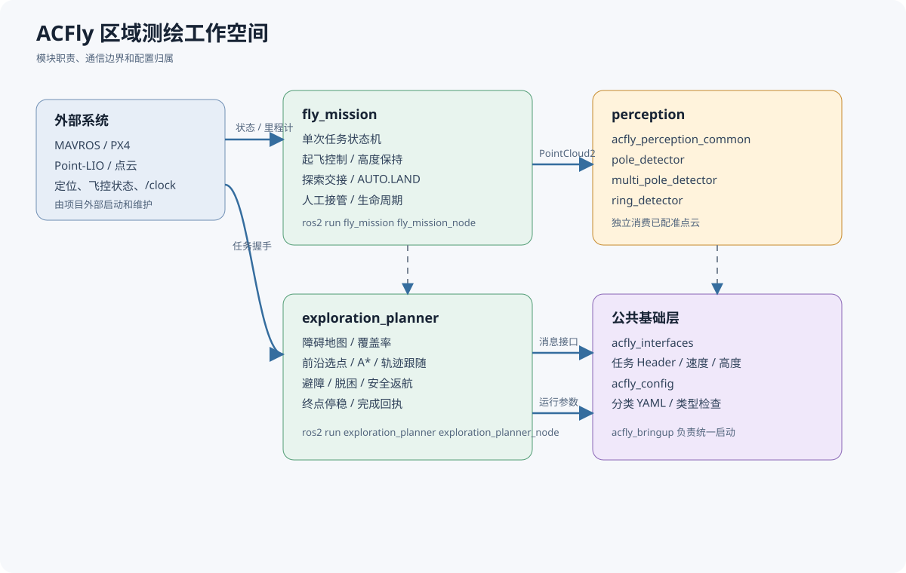
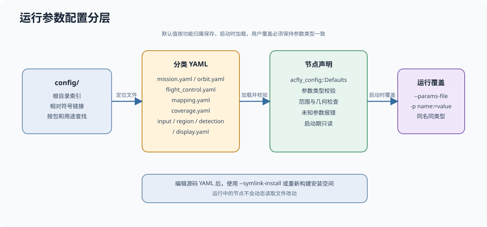

# ACFly 项目概览

## 文件导览（纯文本）

先按文本树从外到内定位文件职责，再看模块图。完整逐文件说明在 [FILE_GUIDE.md](FILE_GUIDE.md)，它覆盖根目录、每个 ROS 包、配置、源码、测试和配图源文件。

```text
acfly_ws/
├── config/                    各包 YAML 的统一编辑入口
├── src/                       ROS 2 源码
│   ├── acfly_interfaces/      消息协议
│   ├── acfly_config/          参数声明与校验
│   ├── acfly_bringup/         统一启动
│   ├── fly_mission/           单次任务主控
│   ├── exploration_planner/   区域探索与返航
│   └── perception/            公共库与三个检测器
├── docs/                      说明、历史证据和可编辑图表源
└── tools/                     检查、隔离验证、仿真和图表导出
```

ACFly 是一个基于 ROS 2 Humble 的无人机区域测绘工作空间。项目把飞行任务、区域探索、点云几何检测、消息接口和运行参数拆成独立模块，方便新成员理解代码、定位问题和替换单个功能。

项目默认由 fly_mission 和 exploration_planner 协作完成一次区域测绘。主控负责地面自检、人工放行、起飞、巡航高度保持、探索交接和降落。探索规划器负责障碍地图、覆盖率统计、前沿选点、避障、轨迹跟随和安全返航。三个感知节点从已配准点云中提取静态杆体或圆环测量值。PX4、MAVROS、Point-LIO、雷达驱动和相机驱动属于外部系统，由现场环境单独启动。



架构图的可编辑源文件是 [assets/architecture.mmd](assets/architecture.mmd)，配置图的可编辑源文件是 [assets/config-layers.mmd](assets/config-layers.mmd)。SVG 只负责 GitHub 预览；修改关系时编辑 Mermaid 源文件，再运行 `tools/render_diagrams.sh` 更新预览。图表源和导出规则见 [assets/README.md](assets/README.md)。

## 项目结构

~~~text
acfly_ws/
├── src/
│   ├── fly_mission/                    # 单次任务主控
│   ├── exploration_planner/            # 区域覆盖、地图、避障和返航
│   ├── perception/
│   │   ├── acfly_perception_common/    # 公共点云输入、裁剪、滑窗和拟合
│   │   ├── pole_detector/              # 单杆检测
│   │   ├── multi_pole_detector/        # 多杆聚类和编号
│   │   └── ring_detector/              # 圆环拟合
│   ├── acfly_interfaces/               # ROS 消息定义
│   ├── acfly_config/                   # 分类 YAML 加载和校验
│   └── acfly_bringup/                  # 统一启动入口
├── config/                             # 各包 YAML 的编辑索引
├── docs/                               # 项目说明、维护手册和历史记录
├── tools/                              # 结构检查和隔离验证
└── build/ install/ log/                # 本机构建与历史验证资料
~~~

每个 ROS 包都有自己的 package.xml 和 CMakeLists.txt。包内源代码只负责本包职责，跨包通信通过 acfly_interfaces 中的消息完成。acfly_config 只负责加载和检查默认参数，不包含任务算法。

更细的文件职责、故障定位路径和修改约定见 [维护手册](MAINTENANCE.md)。参数编辑入口见 [配置索引](../config/README.md)。

## 模块职责

| 模块 | 主要内容 | 运行入口 |
| --- | --- | --- |
| fly_mission | 地面自检、人工放行、起飞、巡航高度保持、探索交接、AUTO.LAND、上锁退出和飞手接管 | ros2 run fly_mission fly_mission_node |
| exploration_planner | 点云新鲜度、解锁后障碍累计、覆盖率、前沿搜索、路径规划、轨迹控制、脱困和返航 | ros2 run exploration_planner exploration_planner_node |
| acfly_perception_common | 点云字段检查、坐标系校验、区域裁剪、滑窗和共享参数读取 | 由三个检测节点链接 |
| pole_detector | 单个静态杆体的中心、半径和方向测量 | ros2 run pole_detector pole_detector_node |
| multi_pole_detector | 点云聚类、多个杆体识别和启动期编号 | ros2 run multi_pole_detector multi_pole_detector_node |
| ring_detector | 平面圆环拟合、中心、半径和法向量测量 | ros2 run ring_detector ring_detector_node |
| acfly_interfaces | 主控和探索之间的任务目标、上下文和速度控制消息 | 编译期依赖 |
| acfly_config | 默认 YAML 读取、类型检查、范围检查和未知参数检查 | 编译期依赖 |
| acfly_bringup | 同时启动主控和探索节点，并接受两个独立覆盖文件 | ros2 launch acfly_bringup survey.launch.py |

## 节点接口

| 话题 | 发布方 | 订阅方 | 用途 |
| --- | --- | --- | --- |
| /exploration/goal | fly_mission | exploration_planner | camera_init 坐标系下的返回终点和任务标识 |
| /exploration/context | fly_mission | exploration_planner | 起飞高度、巡航高度和高度容差 |
| /exploration/control | exploration_planner | fly_mission | 带任务标识的 base_link 速度、巡航高度和垂直速度上限 |
| /exploration/finished_goal | exploration_planner | fly_mission | 与当前任务完全匹配的完成标识 |
| /exploration/coverage | exploration_planner | 监控工具 | 当前覆盖率 |
| /exploration/diagnostics | exploration_planner | 监控工具 | 传感器状态、规划阶段和异常原因 |
| /mavros/state | MAVROS | 主控和探索 | 连接、解锁和模式 |
| /mavros/extended_state | MAVROS | fly_mission | 地面或空中状态 |
| /aft_mapped_to_init | Point-LIO | 主控、探索和感知节点 | 位姿、速度和航向 |
| /cloud_registered | Point-LIO | 探索和感知节点 | 已配准点云 |

任务 Header 会在 goal、context、control 和 finished_goal 之间传递。主控只有收到当前任务的完成标识后才进入降落交接。控制流使用易失 QoS，目标、上下文和完成标识使用瞬态本地 QoS。

## 配置分层

配置默认值放在各包自己的 config 目录。根目录 config 通过符号链接提供统一索引，编辑任意一处都指向同一份文件。



配置图源文件为 [assets/config-layers.mmd](assets/config-layers.mmd)，后续新增参数层时只需修改源文件并重新导出。

主控配置分为三组。

- mission.yaml 保存起飞高度、返回点和任务放行选项
- flight_control.yaml 保存控制周期、速度上限、位置保持和容差
- watchdogs.yaml 保存定位、飞控、控制指令和降落请求的有效期

探索配置分为五组。

- mapping.yaml 保存地图边界、网格、雷达视野和障碍累计
- coverage.yaml 保存覆盖率门槛、前沿评分和重规划
- motion.yaml 保存速度、加减速、转弯和避障
- return.yaml 保存返航路径、末段减速和终点停稳
- runtime.yaml 保存主循环、传感器超时和诊断周期

每个感知节点都有四组配置。

- input.yaml 保存输入话题、里程计话题和坐标系
- region.yaml 保存三维裁剪范围
- detection.yaml 保存拟合和滑窗参数
- display.yaml 保存显示话题和 Marker 参数

配置在节点启动时读取。可以使用 --params-file 或 -p name:=value 做单次覆盖。覆盖参数必须与默认值使用相同类型。修改源码 YAML 后，需要重新安装配置或使用 --symlink-install，然后重启节点。

## 构建和启动

下面的命令会使用新的构建、安装和日志目录。

~~~bash
cd ~/acfly_ws
source /opt/ros/humble/setup.bash

CMAKE_BUILD_PARALLEL_LEVEL=2 colcon build \
  --base-paths src \
  --build-base build/survey \
  --install-base install/survey \
  --log-base log/survey \
  --symlink-install \
  --executor sequential

source install/survey/setup.bash
ros2 launch acfly_bringup survey.launch.py
~~~

已有 PX4、MAVROS 和 Point-LIO 环境时，可以分别覆盖主控和探索配置。

~~~bash
ros2 launch acfly_bringup survey.launch.py \
  planner_params:=/absolute/path/planner_override.yaml \
  mission_params:=/absolute/path/mission_override.yaml
~~~

外部传感器、MAVROS、PX4 和 Point-LIO 按现场启动流程运行。主控启动后需要看到新鲜定位、MAVROS 连接、ON_GROUND 状态、规划器通信端点和本进程内的地面上锁状态，才会接受人工放行。

## 验证

结构和配置检查。

~~~bash
python3 tools/check_workspace.py
~~~

隔离构建和测试。

~~~bash
tools/test_workspace.bash
~~~

验证脚本会复制 src/ 到临时工作空间，从系统 ROS 2 Humble 环境构建并运行测试。测试覆盖配置加载和覆盖、公共点云格式、探索规划器、主控生命周期、跨节点握手以及三个感知节点的合成点云输入。测试不启动飞控，也不连接现场硬件。

## 修改约定

新功能放到拥有该职责的包中。ROS 回调、参数读取、算法实现和节点生命周期分开维护。新增运行参数时，只在对应分类 YAML 中放置默认值，并在节点创建时检查类型、范围和几何关系。新增包或配置分类时，同步更新包安装规则、根目录配置索引、维护手册和隔离测试。

接口消息变更后，需要同时重建 acfly_interfaces、主控、探索规划器和相关测试。运行中的节点不会自动加载源码或 YAML 的改动。

## 当前验证边界

当前工作区已经完成本机结构整理、隔离构建和离线测试。完整 Gazebo 闭环、真实雷达、飞行动力学和实飞结果需要在现场环境中单独验证。历史调参资料保存在 docs/ 和 build/ 的历史目录中，不能直接当作当前版本的运行参数或飞行结论。
